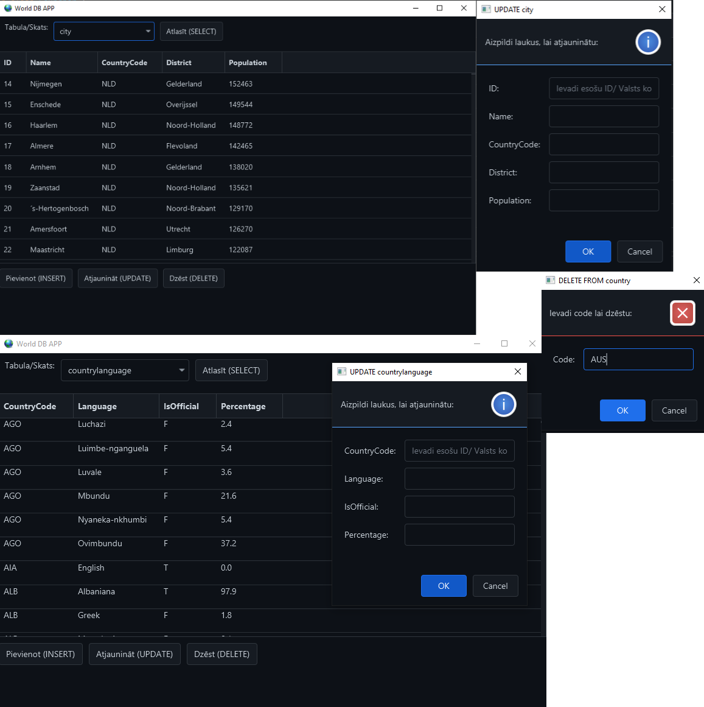

# Maven World DB

## Programmas apraksts
Programma kas atlasa datus no DB World un parāda tos caur JavaFX GUI.
Var veikt dažādas operācijas, kā SELECT, INSERT, UPDATE un DELETE un skatīt skatus.
Programma ir arī neliela datu validācija, kas pārbauda vai ir ievādīti dati ievada laukumā.

## Ekrānšāviņi

## Autors
Emīls Smirnovs
